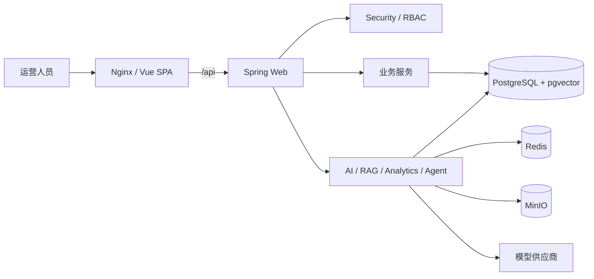

# SmartMall TLAI

面向商城运营后台的全栈 AI 应用示例：以订单、退款、售后和权限管理为业务底座，提供知识库 RAG、受控自然语言分析、可审计 Agent、会话持久化及模型调用观测。

## 能力概览

- 商品、客户、订单、退款、售后工单完整业务闭环，关键状态迁移使用条件更新防并发重复执行。
- Spring Security + JWT + RBAC，接口方法级权限与前端路由权限双层约束。
- 多供应商 Chat/Embedding 配置，API Key 使用 AES-256-GCM 加密入库，主密钥不入库。
- 文档上传至 MinIO，解析切片后写入 pgvector，仅检索 `READY` 文档并返回引用来源。
- Analytics 只接受固定 DSL，模型不能直接生成或执行 SQL。
- Agent 通过能力白名单选工具；只读操作自动执行，写操作生成短时确认令牌并二次校验用户和权限。
- AI 调用日志与 Agent 审计通过 `traceId`、`conversationId` 关联，敏感提示词、回答和密钥不落审计表。

## 技术栈

| 层 | 技术 |
|---|---|
| 后端 | Java 21、Spring Boot 3.5、Spring Security、MyBatis-Plus、Flyway、Spring AI |
| 前端 | Vue 3、TypeScript 5、Vite 7、Pinia、Element Plus、ECharts |
| 数据 | PostgreSQL 16 + pgvector、Redis 7、MinIO |
| 部署 | Docker 多阶段构建、Nginx、Docker Compose |
| 测试 | JUnit 5、Mockito、AssertJ、Node 22 `node:test` |

## 架构



后端是统一部署的模块化单体，详细职责和依赖见 [架构说明](docs/架构说明.md)，核心表关系见 [数据库关系图](docs/数据库关系图.md)。

## 本地开发

前置版本：JDK 21、Maven 3.9、Node.js 22、pnpm 10，以及可用的 PostgreSQL/pgvector、Redis、MinIO。复制 `.env.example` 中的变量到本地安全配置，替换所有占位值；不要提交 `.env` 或 `application-local.yml`。

```powershell
cd backend
mvn test

cd ..\frontend
pnpm install --frozen-lockfile
pnpm test
pnpm build
```

后端唯一入口为 `smartmall-application` 模块中的 `SmartMallTlaiApplication`。更细的本地配置见 [本地启动指南](docs/本地启动指南.md)。

## 生产部署

生产拓扑仅由 Nginx 发布一个 HTTP 端口；PostgreSQL、Redis、MinIO 和后端均只在 Compose 网络内可见。部署前必须设置独立强密码、JWT 密钥和 AI 加密主密钥：

```bash
cp deploy/.env.example deploy/.env
# 编辑 deploy/.env，替换所有 replace-with-* 值
docker compose --env-file deploy/.env -f deploy/compose.yaml config
docker compose --env-file deploy/.env -f deploy/compose.yaml up -d --build
```

完整的健康检查、HTTPS 接入、备份与恢复说明见 [部署指南](deploy/README.md)。仓库不会自动执行恢复脚本；恢复必须显式传入 `--confirm-overwrite`。

## AI 评测

固定中文评测集位于 `evals/`。默认命令只校验数据集结构，报告会明确写明“真实模型未执行”，不会制造准确率、耗时或 Token：

```bash
python evals/run_evals.py
```

真实模型入口需要显式授权、服务地址和短时测试令牌，详见 [评测说明](evals/README.md)。

## 文档索引

- [API 说明](docs/API说明.md)
- [AI 模型与助手说明](docs/AI模型与助手说明.md)
- [前后端交互与菜单路由](docs/前后端交互与菜单路由.md)
- [阶段 9 验收说明](docs/阶段9工程化验收说明.md)
- [面试讲解提纲](docs/面试讲解提纲.md)
- [项目截图清单](docs/项目截图清单.md)

## 安全边界

示例配置只含占位值。日志和审计不应记录密码、API Key、JWT、完整提示词或完整回答；Analytics 不接受原始 SQL；Agent 的前端按钮不是授权边界，所有权限和确认均由后端重新校验。

## License

[MIT](LICENSE)
