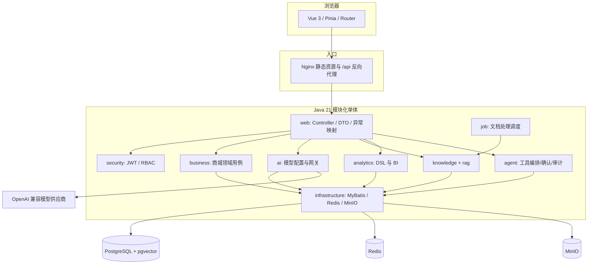

# 架构说明

SmartMall TLAI 采用前后端分离与后端模块化单体。Maven 模块建立依赖边界，但最终由 `smartmall-application` 打成一个进程，避免演示项目过早引入分布式事务和服务治理成本。

## 关键设计

1. 业务状态机：订单支付/取消、退款审核使用数据库条件更新；事务内更新关联状态和库存，避免重复点击造成重复释放库存。
2. 权限：JWT 只负责身份，权限从用户加载；Controller 使用 `@PreAuthorize`。Agent 在规划、确认、执行三个位置都不信任前端权限。
3. AI 密钥：供应商凭据用 AES-256-GCM 加密；主密钥来自环境变量。错误信息不回显密文、明文或主密钥。
4. RAG：问题先向量化，SQL 固定过滤 `knowledge_document.status = 'READY'`；检索片段被标为不可信数据并按字符上限截断。
5. Analytics：模型只生成六字段 JSON DSL，后端再次检查枚举、组合、日期范围和 limit；实际 SQL 固定在 Mapper。
6. Agent：能力注册表同时保存工具类型和权限。只读工具可执行；写工具只创建 10 分钟确认记录，令牌只存 SHA-256 摘要，确认时核对所有者、时效和当前权限。
7. 可观测性：模型日志只保存供应商、模型、场景、状态、规模和耗时；Agent 审计只保存受控参数摘要。两者通过 trace/conversation 关联。

## 依赖方向

领域模块不依赖 Web 或持久化实现；Repository 接口位于领域模块，实现位于 infrastructure。`application` 是组合根，负责配置、Flyway 和启动。这使核心用例能在无数据库、无网络的单元测试中验证。
